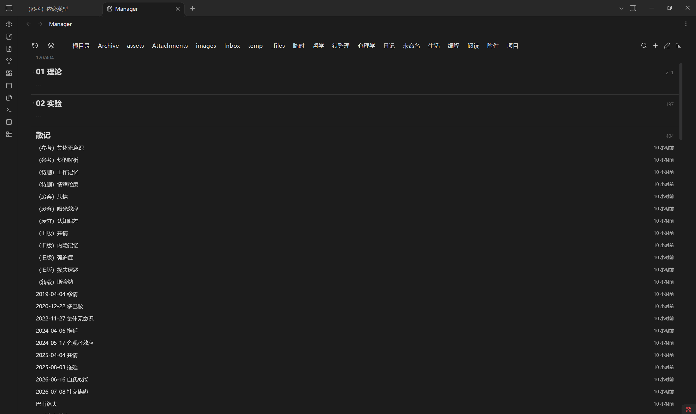
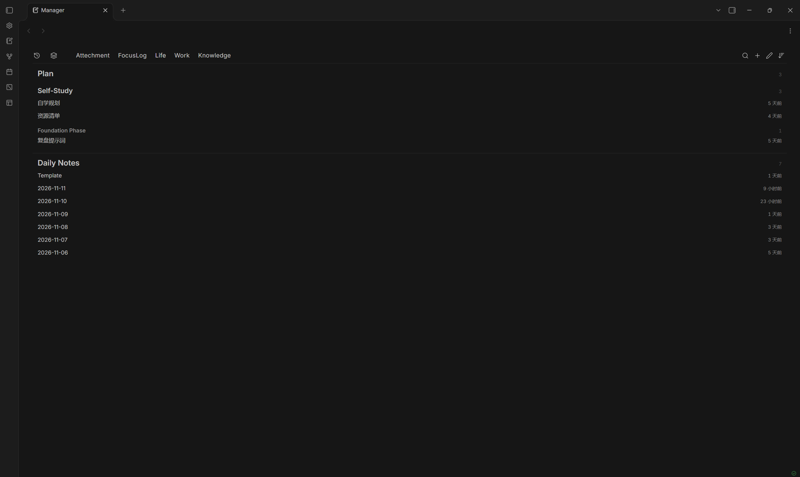
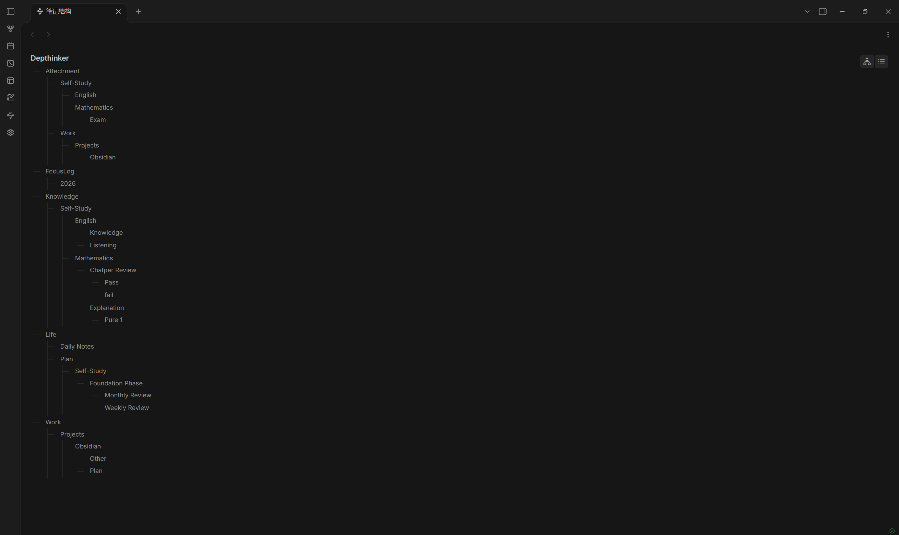
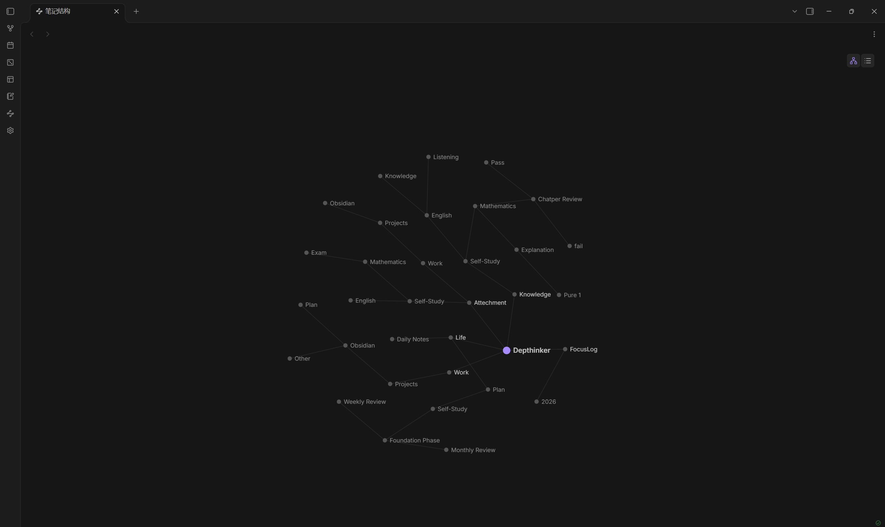

# Note Manager

A file manager for your vault: sort, search and reorganise notes, PDFs, images and canvas from one wide view.






Supported languages: English, 简体中文, 繁體中文, 日本語, 한국어, Deutsch, Français, Español, Русский, Italiano, Português, Polski, Nederlands, Türkçe, Українська, Bahasa Indonesia, Svenska, Dansk, Norsk, Suomi, Čeština, Slovenčina, Slovenščina, Srpski, Hrvatski, Magyar, Română, Català, Ελληνικά, हिन्दी, ไทย, Беларуская

---

## What it does

Manager is, in a sense, a replacement for the file list. The built-in file explorer lives in a narrow sidebar, which makes real note management hard; Manager takes the main area, which makes tidying up far easier.

It sorts and groups notes using each file's path, name, size, modification time, creation time and link count — nothing else, no content is read.

---

## Using it

### Top bar

1. Two icons: a clock with a rewind arrow for notes sorted by when they were last modified, and a stacked-layers shape for all files in the vault
2. Location: the root folder plus the names of first-level folders
3. Four fixed icons on the right: search, plus, pencil, sort

- Text is grey by default and brightens when selected
- Root appears only when the vault root actually holds files

### Search

- Click the search icon and a bordered input slides out from its left edge, covering the whole location strip

Right-click the search icon to switch scope:

- Note titles
- All text

Esc clears and closes it.

### Plus

Click it and you get New note and New folder.

Pick one and the plus turns into a checkmark: you are now in create mode. Click a folder name in the top bar, or any folder heading in the list, to choose where the file goes.

Click the checkmark to commit.

- New note: named `Untitled`, opens in the current tab once created
- New folder: named `Untitled folder`, goes straight into rename afterwards

### Pencil

Click to enter reorder mode.

Folder names in the top bar can be dragged; this only changes display order and is saved to plugin settings. Folder headings and files in the list can be moved as well.

### Sort

- Name, A to Z
- Name, Z to A
- Modified, newest first
- Modified, oldest first
- Created, newest first
- Created, oldest first
- Size, largest first

### Below the divider

Folders are headings, files sit under them.

Type size steps down by level:

- First-level folder 18
- Second level 16
- Third level and deeper 13, in grey

Click a folder heading to collapse its contents.

Each row can carry two columns on the right: file size and how long ago the file was modified. Both are off by default except the time. Folder headings always show how many files sit inside, and their total size once the size column is on.

### Motion

- Switching tabs, changing sort, collapsing and expanding: the list fades in as a whole
- Menus fade in as they appear
- The plus and pencil bounce when they turn into checkmarks

All of it can be turned off in settings.

---

## On mobile

The plugin runs on iOS and Android as well as desktop.

- Rows and toolbar icons grow on coarse pointers, so a finger has something to hit
- Long-press a row for the same menu a right-click gives on desktop
- The keyboard mode toggle is left out — there is no physical keyboard for it to serve
- Search, filter tokens, creating, sorting and the structure view all behave the same
- Dragging files onto a folder is desktop only: touch dragging is not HTML5 drag, and the list needs that gesture for scrolling

---

## Keyboard

The last icon on the right switches keyboard mode on and off.

Off, which is the default, a single click opens a file — what a file list has always done. On, a single click only moves the focus ring and a double click opens. That is the mode to use when you are rearranging rather than reading, and it is what makes the keys below usable without hunting for a click target first.

The list also picks up focus whenever you click a row. From there:

- `Up` `Down` or `k` `j` — move the focus ring
- `Home` / `End` — first or last row
- `PgUp` / `PgDn` — a screen at a time
- `Enter` — open a file, or collapse and expand a folder
- `/` — jump into the filter box from anywhere in the view
- `Esc` — clear the filter, or leave create and reorder modes
- `Ctrl+A` — mark every visible row

## Row marks

Each row can carry a small icon on the right, next to the size and time columns, so the state of a file stays visible while you browse instead of living in a report you have to open.

- Plug pulled out — an attachment nothing links to
- Hourglass — a note untouched for over a year
- Broken chain — a note with no outgoing links
- Folder with a dash, beside an empty folder — nothing inside it

The icons sit on the right on purpose: anything on the left would push note titles inward and knock them out of line with folder headings.

A note can show two at once — old and not linking anywhere. They come from a single pass over `metadataCache.resolvedLinks` while the index is built, so keeping them on costs nothing.

Turn them off in settings; they are on by default.

---

## Selecting several

- `Ctrl` (or `Cmd`) click adds or removes one row
- `Shift` click selects the run between the anchor and the row you clicked
- `Ctrl+A` takes everything currently visible
- Drag any selected row onto a folder header to move the whole set at once
- `Delete` asks once, then removes them all
- `Ctrl+Shift+R` renames them in order: `Note-001`, `Note-002`, and so on, keeping each extension

Folder headers are not selectable — clicking one still collapses it, which is what that click means everywhere else in the app.

The count sits in the status line while a selection exists.

---

## Note structure

The third icon in the ribbon opens a structure view of the whole vault: the vault name, then every folder branching out down to the leaf folders.

Two styles, switched by the two icons in the top right corner of the view — the same setting also lives in the settings page:

- Animated, the default — a graph. The vault sits at the centre, levels spread outward, then a small force simulation pushes overlapping labels apart. Links draw themselves in and nodes fade in by depth. Drag any node and it follows the pointer; let go and it settles back. Drag the empty background to pan.
- Static — an indented tree with hairline connectors, easier to scan when the vault runs deep.

The simulation is four numbers: 1400/d² repulsion, springs targeting 110, centre gravity 0.0025, damping 0.86. Past 400 nodes it skips the simulation and draws the final positions directly.

Both read the same index the list does, so blocked folders stay out and the picture matches the disk.

The ribbon icon can be turned off in settings; the command palette entry stays either way.

---

## Filter

The search box takes more than words. Conditions narrow the same table in place: you can still drag rows, create files and rename while it is filtered.

| Token | Meaning |
| --- | --- |
| `.pdf` | by extension, several allowed |
| `>10mb` `<500kb` | by size, in `b` `kb` `mb` `gb` |
| `today` `week` `month` | modified inside that window |
| `2026-11` `2026-11-11` | a month, or a day |
| `empty` | folders with nothing inside |
| anything else | matched against the name |

In the All view, `.pdf today` lists every PDF modified today across the vault. Conditions with an extension, size or date flatten the result and hide folder headings, because the point of those queries is the files themselves.

---

## Supported file types

- Notes `.md`
- PDF `.pdf`
- Images `.png` `.jpg` `.jpeg` `.gif` `.webp` `.svg` `.bmp`
- Audio `.mp3` `.wav` `.m4a` `.ogg` `.flac` `.3gp`
- Video `.mp4` `.webm` `.ogv` `.mov` `.mkv`
- Canvas `.canvas`

---

## Where data lives

- `tabOrder`: top bar order, an array of paths
- `noteOrder`: manual file order per directory
- `folderOrder`: manual folder order per directory
- `collapsed`: folders that are collapsed
- `sortMode`: current sort
- `searchScope`: search scope, `title` or `full`
- `listLimit`: rows rendered per pass, 120 by default
- `blockedFolders`: block list, newline-separated string
- `showAll` `showRecent`: toggles for the two top-bar views
- `showEmptyFolders`: whether empty folders show
- `showSettingsIcon`: toggle for the ribbon gear
- `homePage`: whether Manager opens on startup
- `collapseSidebar`: whether the left sidebar collapses on open
- `animations`: interface animation toggle
- `keyboardMode`: single click selects instead of opening
- `showSize`: file size column
- `showTime`: modified time column
- `density`: `compact`, `normal` or `comfortable`
- `showMapIcon`: the structure view icon in the ribbon
- `mapMode`: `dynamic` or `static`

---

## No build step

Manager ships as one file. There is no bundler, no `node_modules`, no compile pass, nothing to `npm install` before you can read the source: `main.js` is 5,547 lines and every one of them is the code that runs. Open it and read it.

The only outside name it reaches for is `obsidian`, which the app injects at load time. Everything else is plain JavaScript.

## Test

```
node test.cjs
```

`test.cjs` swaps `require("obsidian")` for a stub, loads `main.js` unchanged and exercises the pure functions exported on `__core`: path handling, name collisions, sort comparators, row building. No framework, no fixtures, one file.

---

## Version

1.0.8

- Renames and deletions now go through `fileManager`, so renames update links and deletions go to the trash instead of vanishing
- Dropped Arabic, Hebrew and Persian: the layout is left to right, and half-supported right-to-left is worse than not claiming it
- Row marks are off by default — nearly every note has no outgoing links, so the dots were on almost every row
- README numbers corrected: line count, sort keys, language count

1.0.7

- Row marks: orphan attachments, stale notes and notes without outgoing links, as icons on the right
- Computed in a single pass over the link cache, no separate scan
- Can be turned off in settings; on by default

1.0.6

- Runs on mobile: larger touch targets, long-press for the file menu
- The keyboard mode toggle is hidden on mobile

1.0.5

- Ctrl and Shift selection, with the count in the status line
- Drag a selection onto a folder to move every item
- Delete asks once for the whole selection
- Batch rename numbers the selection `Note-001`, `Note-002`, keeping extensions

1.0.4

- Size column on every row, plus the recursive size beside every folder heading
- Seventh sort order: size, largest first
- Three densities — compact, regular, comfortable — changing only row height and the type scale
- Note structure view: the whole vault as a draggable force graph or an indented tree, toggled from its top right corner
- Fixed: the status line said zero results while the list still had rows

1.0.3

- Keyboard mode toggle on the far right: single click selects, double click opens
- Keyboard navigation: arrows and `j` / `k`, Home and End, PgUp and PgDn, Enter, `/` to filter, Esc to leave, Ctrl+A to mark
- Filter tokens in the search box: `.pdf`, `>10mb`, `today`, `week`, `month`, `2026-11`, `empty`, mixed freely with names
- Fixed: the status line said zero results while the list still had rows

1.0.2

- Renamed to Note Manager, with a description that says what it actually does
- README no longer lists build and test commands that do not exist in the plugin folder
- Fixed: Recent sorts by modification time, not by when a note was last opened
- Added screenshots and a `test.cjs` you can run on its own

1.0.1

- Manifest description now ends with a full stop
- The top bar fade no longer depends on CSS masks, which older builds only partly support
- Removed a duplicated overflow declaration on the status line
- Removed every `!important`; the animation switch now zeroes the duration variables instead

1.0.0

- Top bar: Recent and All as icons, locations as text, two groups, horizontally scrollable
- List: folder headings and files, stepped type size, collapsible
- File types: notes, PDF, images, audio, video, canvas
- Search: title and full-text scopes, switched by right-click
- Create: plus opens two choices, pick a target then commit
- Sort: six orders, icon follows direction
- Drag: top bar changes order only, the list really moves files
- Context menu: the same one the file explorer uses
- Settings: block list, empty folders, the two top-bar views, settings icon, home page, animation, sidebar
- Languages: eight
- Motion: list fade, menu pop, icon bounce
